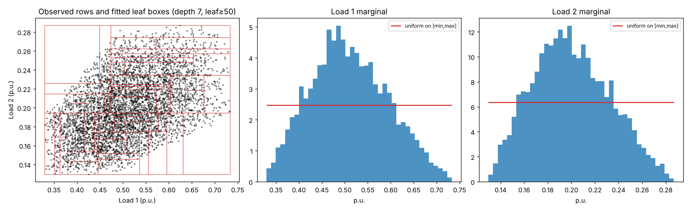
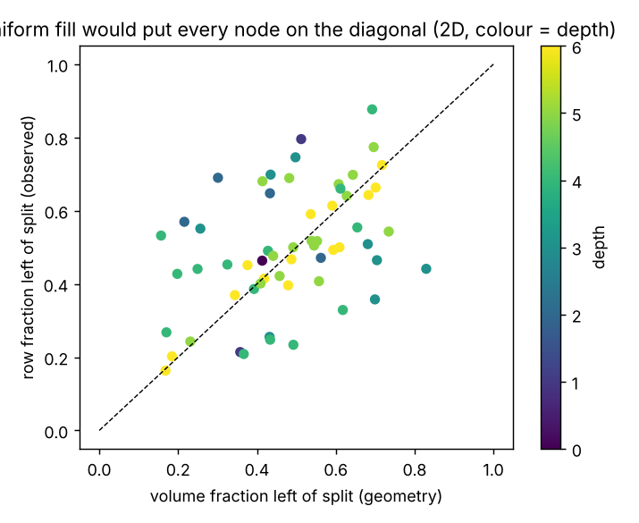

# Diagnostic: are the OPFData predictors uniformly distributed?

**Why this matters.** The effective-centre Hessian reconstruction places each node's slope estimate at
`(lo + tau + hi) / 3` along the split axis and at the box midpoint along the others. That location is derived
assuming the rows fill every box **evenly** (uniform measure on the box). If they do not, the slope is attributed
to the wrong point and the curvature system is built on mislocated equations. This folder measures how far the
observed data are from that assumption, globally and inside the boxes of an actual fitted tree.

**Data.** `118_ieee_smol.csv`, columns 1–3 (Load 1–3), 5,000 rows. Trees: `DecisionTreeRegressor(max_depth=7,
min_samples_leaf=50, random_state=0)` fitted to cost on Loads 1–2 (2D) and 1–3 (3D).

## Files

| file | content |
|---|---|
| `predictor_uniformity.ipynb` | the same test as an executed notebook with figures inline |
| `check_uniformity.py` | the test as a script; prints a summary and writes the three files below |
| `uniformity_2d.png` | observed rows with fitted leaf boxes; per-load histograms against the uniform density on [min, max] |
| `left_fraction_2d.png` | for every internal node, row fraction left of the split vs. volume fraction left of the split; uniform fill would lie on the diagonal |
| `within_box_uniformity.csv` | one row per internal node: depth, rows, split axis, geometric and observed left fractions, their gap, minimum per-axis KS p-value, largest centroid offset / width |

## Results

### Figure 1 — observed rows, fitted leaf boxes, and the per-load histograms against a uniform density

**Whole dataset — not uniform, not independent.**

| | Load 1 | Load 2 | Load 3 | uniform would give |
|---|---|---|---|---|
| KS statistic vs. Uniform[min, max] | 0.175 | 0.172 | 0.162 | ≈0 |
| KS p-value | 4e-135 | 1e-129 | 1e-115 | — |
| variance of scaled load | 0.0425 | 0.0424 | 0.0451 | 0.0833 |
| fraction of rows in the central half of the range | 0.73 | 0.73 | 0.71 | 0.50 |

Pairwise correlations between the loads are 0.47–0.49 (independent uniform: 0). Each load's histogram is
bell-shaped and the rows concentrate along the "all loads up / all loads down" diagonal.

### Figure 2 — inside each fitted box: observed vs. geometric fraction of rows left of the split

**Inside the fitted boxes — the assumption the formula relies on.**

| | 2D (59 internal nodes) | 3D (46 internal nodes) |
|---|---|---|
| boxes whose fill fails a per-axis KS uniformity test (p < 0.05) | 71 % | 96 % |
| \|row fraction left of split − volume fraction left\|, mean / max | 0.13 / 0.39 | 0.21 / 0.46 |
| centroid offset from box centre as a fraction of width, mean / max | 0.11 / 0.33 | 0.16 / 0.33 |

By depth (mean |left-fraction gap|, 2D): root 0.05 → depths 1–3 **0.21–0.27** → depths 5–6 0.04–0.08. Shallow
boxes are large and straddle the bell-shaped density, so their fill is lopsided; deep boxes are small enough that
the density is nearly flat across them. The mid-depth nodes are also the ones that contribute most pairs to the
least-squares system.

## Reading

The uniform-fill assumption is violated throughout, more so in 3D than in 2D, and most strongly at the depths that
dominate the curvature equations. This is independent evidence for the same conclusion as the controlled check in
`attempt_02` §8: the effective-centre location is off by up to a third of a box width on real data, in addition to
the averaging noise from small cells.

## What this does not do

It does not estimate a Hessian or change the method. The natural follow-up — computing each node's location from
the rows actually in its children instead of from the box geometry — changes the derivation and should be run as
its own documented experiment with the hypothesis stated first.

Requires `numpy pandas scipy scikit-learn matplotlib`.
